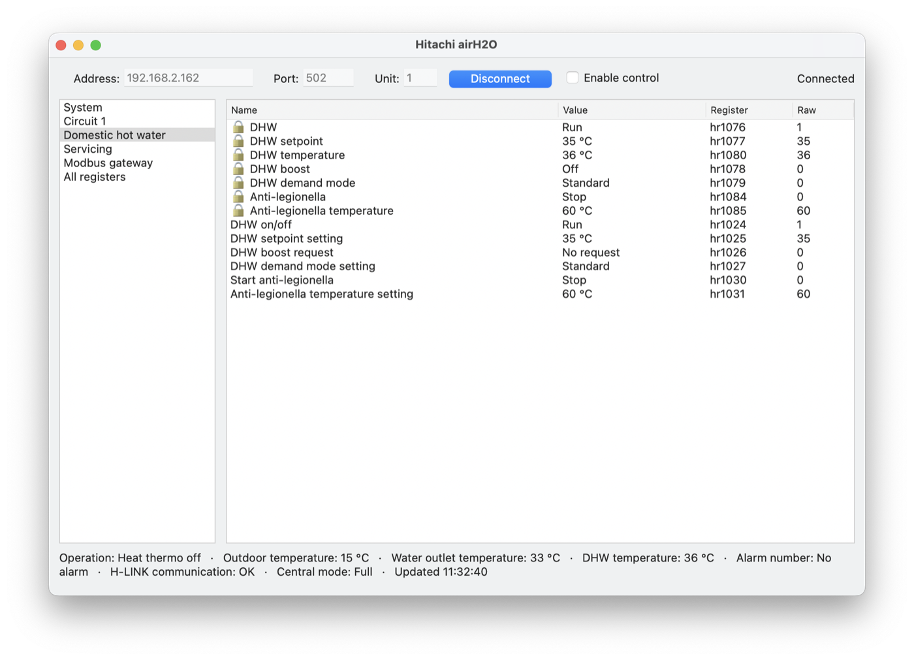

# VNS Xojo Modbus

A **Modbus client library for [Xojo](https://www.xojo.com)** — Modbus **TCP** over Ethernet and
Modbus **RTU** over a serial line — written in pure Xojo code (API 2):
no plugin, no native library, no `Declare` — written for macOS, Windows and Linux (tested on
macOS; Windows and Linux reports welcome). Free and open source under the
[MIT licence](LICENSE).

It ships with two apps:

- **VNS Modbus TCP** — a complete application for the **Hitachi airH2O / Yutaki heat pump**
  (ATW-MBS-02 Modbus gateway): live monitoring of the heating circuits, domestic hot water, pool
  and servicing data, and control of setpoints and modes.
- **VNS Modbus RTU** — a generic tester for any Modbus RTU device on a serial line.

> ⚠️ **The RTU part (`ModbusRTUClient` and VNS Modbus RTU) has not been tested on a real device:
> the author does not have a serial Modbus device to test with.** Its frames and CRCs are checked
> by the self-test; real-line reports are welcome — see [docs/RTU_TESTING.md](docs/RTU_TESTING.md).

## Features

- Function codes 01, 02, 03, 04, 05, 06, 15, 16, 22 (mask write), 23 (read/write multiple
  registers), 08 / 00 (loopback), 17 (report server id) and 43 / 14 (read device identification)
- Two clients with the same API: `ModbusTCPClient` (Ethernet) and `ModbusRTUClient` (serial line,
  RTU framing with CRC-16 — untested on hardware)
- Asynchronous and event-driven — never blocks the user interface; drop it on a window and fill
  in its events, no `AddHandler` needed
- Request queue, transaction-ID matching, timeouts, automatic reconnection, readable error texts
- Values of 16, 32 and 64 bits, signed, unsigned and float, in the four word orders
  (ABCD, CDAB, BADC, DCBA)
- Named **points** (`hr1080:int16`, `ir30:float32:cdab`, `co5`, `hr1089.4`) with scaling, units,
  labels for coded values and bitfields, "no data" values, write ranges
- A whole device described as a **plain-text table** of points
- **Poller** that reads all points in as few requests as possible and writes values safely
- Built-in self-test, a Modbus TCP simulator and a console test project

## Requirements and status

- Xojo **2026r2.1** or later (API 2). Desktop and Console projects; Web should work too (see the
  [developer guide § 11](docs/DEVELOPER_GUIDE.md#11-console-web-and-threads)) but is not tested yet.
- Tested so far on **macOS**: desktop and console, every function code against the simulator, and
  a real Hitachi ATW-MBS-02 gateway. **RTU: not tested on a real serial device yet.**
  Windows and Linux use no platform-specific code but have not been tried yet — reports welcome.

## Repository layout

| Folder | Content |
|--------|---------|
| [`Modbus/`](Modbus) | **The library** — the only folder you copy into your project |
| [`VNS-Modbus-TCP/`](VNS-Modbus-TCP) | The app **VNS Modbus TCP** (Hitachi airH2O example): project, register table, windows, settings |
| [`VNS-Modbus-RTU/`](VNS-Modbus-RTU) | The app **VNS Modbus RTU**, a serial Modbus tester — [read its README first](VNS-Modbus-RTU/README.md) |
| [`docs/`](docs) | [Developer guide](docs/DEVELOPER_GUIDE.md), [Modbus protocol reference](docs/MODBUS_PROTOCOL.md), [Hitachi register map](docs/HITACHI_REGISTERS.md), [RTU testing guide](docs/RTU_TESTING.md) |
| [`tools/`](tools) | Modbus TCP simulator (generic or airH2O) and a read-only probe, in Python |
| [`tests/`](tests) | Console project checking every function code against the simulator |

## Installation

Copy the [`Modbus`](Modbus) folder next to your project and drag it into the Xojo Navigator.
That's all — it has no other dependency.

## Quick start

Drag a `ModbusTCPClient` onto your window (it is a `TCPSocket` subclass), name it
`ModbusClient1`, and implement its `RequestCompleted` event in the IDE:

```xojo
' in the window's Opening event
ModbusClient1.Address = "192.168.1.50"
ModbusClient1.Port = 502
ModbusClient1.UnitID = 1
ModbusClient1.ReadHoldingRegisters(0, 10)   ' connects automatically

' ModbusClient1.RequestCompleted(request As ModbusRequest)
For i As Integer = 0 To request.Values.LastIndex
  Var registerAddress As Integer = request.Address + i
  System.DebugLog("register " + registerAddress.ToString + " = " + request.Values(i).ToString)
Next

' in the window's Closing event
ModbusClient1.Close
```

The full walk-through — connecting, reading, writing, describing a device as a table of points,
polling, error handling — is in the **[Developer guide](docs/DEVELOPER_GUIDE.md)**.

## The Hitachi airH2O example app



Open `VNS-Modbus-TCP/VNS-Modbus-TCP.xojo_project` (the app **VNS Modbus TCP**) in Xojo 2026r2.1 or later and run it. It starts on the
simulator (`127.0.0.1`, port 5020 — start it with `python3 tools/airh2o_simulator.py --drift`);
type the address and port of your gateway — 502 is the Modbus TCP default, but it can be
changed in the gateway's network settings — and press **Connect**. The address, port, last section
and window size are remembered.

- The whole heat pump is described by one table of 123 points (`VNS-Modbus-TCP/HitachiAirH2O/AirH2OPoints`),
  read in 5 requests every 5 seconds. The register map is documented in
  [docs/HITACHI_REGISTERS.md](docs/HITACHI_REGISTERS.md).
- Sections: System, Circuit 1 and 2, Domestic hot water, Swimming pool, Servicing, Modbus gateway,
  All registers. Functions the unit does not have are hidden (from register 1089).
- Read-only values carry a 🔒. To change a setting, tick **Enable control** (a confirmation is
  asked) and double-click a line without a lock: a dialog shows the current value and the allowed
  range, and warns before sensitive commands (stopping the unit or a circuit, changing the mode…).

⚠️ The app changes the settings of a real heat pump when control is enabled. Reading always works.
For writes, the unit's **central mode** (register 1088, in the System section) matters: Home
Assistant users report that writes are reset unless it is **Full**; the author's unit reports Full
out of the box. The Hitachi manual only documents the register, not this behaviour.

## The VNS Modbus RTU tester app

> ⚠️ **Not tested on a real device** — the author has no serial Modbus device. See its
> [README](VNS-Modbus-RTU/README.md) and the [testing guide](docs/RTU_TESTING.md).


Open `VNS-Modbus-RTU/VNS-Modbus-RTU.xojo_project`. Choose the serial port, baud rate, frame format
and unit id, send any request (FC 01–06, 08, 15, 16, 17, 22, 23, 43) and see the values and the raw frames in hex.
**Save log…** produces a report to send back.

## Troubleshooting

| Symptom | Cause and fix |
|---------|---------------|
| macOS: *No route to the device (65)* although the device answers from Terminal | macOS 15+ **Local Network privacy**. The app declares `NSLocalNetworkUsageDescription`, so macOS asks once ("Allow … to find devices on your local network?"). Sign the app with your own identity (*Build Settings → macOS → Sign*): an ad hoc signature is not tied to your earlier answer. Even when allowed, macOS re-checks a **new executable** (every debug build) and refuses connections while it does — from a few seconds up to about 30 s. The client retries automatically and connects once macOS is done. A built app connects at once. |
| *Connection refused (61 / 111 / 10061)* | Nothing listens on that port: wrong port, or the gateway's Modbus TCP server is off. |
| *The device did not answer (timeout)* | Wrong address, firewall, or the gateway accepts only some client IP addresses (the ATW-MBS-02 keeps an allowed-master list). |
| Values show `n/a` | The device returned a "no data" value (sensor not fitted, module absent). |
| *Illegal function (exception 1)* | The device does not support that function code (the ATW-MBS-02 refuses FC 01/02 and only writes with FC 06). |

## References

The manuals are not stored in this repository (size and copyright). Download them from the
publishers:

| Document | Link |
|----------|------|
| Modbus Application Protocol Specification V1.1b3, Modbus Messaging on TCP/IP Implementation Guide V1.0b, Modbus over Serial Line V1.02 — summarised in our [protocol reference](docs/MODBUS_PROTOCOL.md) | [modbus.org — specifications](https://modbus.org/modbus-specifications) |
| Hitachi ATW-MBS-02 *Modbus gateway for Yutaki series* — installation and operation manual, PMML0419 (register tables §5.3 "line-up 2016") | [ATW-MBS-02_line_up_2016.pdf](https://github.com/alepee/hass-hitachi_yutaki/blob/main/docs/gateway/datasheets/ATW-MBS-02_line_up_2016.pdf) · [before line-up 2016](https://github.com/alepee/hass-hitachi_yutaki/blob/main/docs/gateway/datasheets/ATW-MBS-02_before_line_up_2016.pdf) (copies kept in the hass-hitachi_yutaki repository) |
| Hitachi airH2O (HWM-W2E-B) — installation and user manual, PMFR0674 (French) | [Hitachi documentation portal](https://documentation.hitachiaircon.com/fr/fr/chauffage/hwm-w2e-b) |
| Hitachi PC-ARFH3E-B wired controller / room thermostat — manual PMFR0679 (French) | [Hitachi documentation portal](https://documentation.hitachiaircon.com/fr/fr/controles/pc-arfh3e-b) |
| hass-hitachi_yutaki — Home Assistant integration for the same gateway (MIT) | [GitHub](https://github.com/alepee/hass-hitachi_yutaki) · [register map](https://github.com/alepee/hass-hitachi_yutaki/blob/main/custom_components/hitachi_yutaki/api/modbus/registers/atw_mbs_02.py) · [gateway notes](https://github.com/alepee/hass-hitachi_yutaki/blob/main/docs/gateway/atw-mbs-02.md) · [sentinel values](https://github.com/alepee/hass-hitachi_yutaki/blob/main/docs/gateway/sentinel-values.md) · [forum thread](https://community.home-assistant.io/t/hitachi-yutaki-control-monitor-hitachi-air-to-water-heat-pumps-via-modbus/986441) |
| libplctag — C library for EtherNet/IP and Modbus TCP (design inspiration) | [GitHub](https://github.com/libplctag/libplctag) |
| Xojo forum — *Modbus TCP, getting started* | [forum.xojo.com](https://forum.xojo.com/t/modbus-tcp/66610) |

## Credits

See [NOTICE](NOTICE). Hitachi, Yutaki and airH2O are trademarks of their respective owners; this
project is not affiliated with Hitachi.

## Changes

See [CHANGELOG.md](CHANGELOG.md).

## Licence

MIT — © 2026 Jean-Yves POCHEZ.
