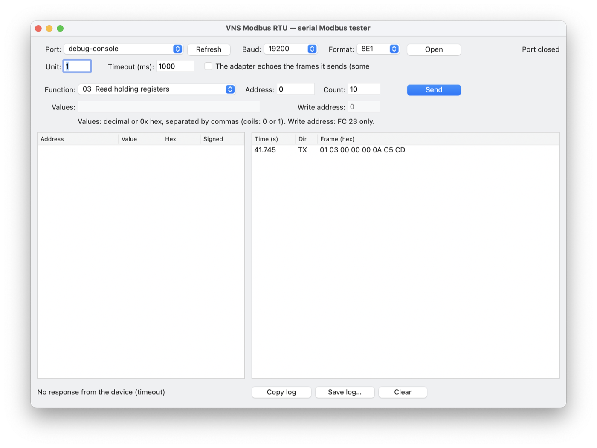

# VNS Modbus RTU — serial Modbus tester

> ## ⚠️ NOT TESTED ON A REAL DEVICE
>
> **This app and the library's RTU client (`ModbusRTUClient`) have not been tested with a real
> Modbus RTU device: the author does not have a serial Modbus device to test with.**
>
> What *has* been checked: the RTU frames, CRC-16 values and answer lengths are verified by the
> library's self-test against reference frames computed independently, and the code compiles on
> macOS. What has *not*: talking to a device over a real serial line (timing, adapters, echo,
> drivers).
>
> If you try it, please report what happens — even "it works". See
> [docs/RTU_TESTING.md](../docs/RTU_TESTING.md) for a short test list and how to send the log.

A small desktop app to talk to **any Modbus RTU device** on a serial line (RS-485 or RS-232,
usually through a USB adapter), built on the [VNS Xojo Modbus](../README.md) library.

## What it does

- Choose the **serial port**, **baud rate** (1200 to 115200) and **frame format** (8E1, 8N1, 8O1,
  8N2, 7E1, 7O1), the **unit id** (1–247, or 0 to broadcast a write) and the **timeout**.
- Send any request: **01** read coils, **02** read discrete inputs, **03** read holding
  registers, **04** read input registers, **05** write single coil, **06** write single register,
  **15** write multiple coils, **16** write multiple registers, **23** read/write multiple
  registers, **22** mask write register, **08** loopback (return query data), **17** report server
  id, **43** read device identification (vendor, product, revision…).
- See the values read (decimal, hex, signed) and the **raw frames** sent and received, in hex.
- **Copy log** / **Save log…**: a report with the versions, platform, settings and every frame,
  to send to the author.
- An option for RS-485 adapters that **echo** the frames they send.
- The settings are remembered.

## Open and run

Open `VNS-Modbus-RTU.xojo_project` in Xojo 2026r2.1 or later. The library is used in place from
[`../Modbus`](../Modbus) — the same files as the TCP app.

Addresses are the **0-based** addresses sent on the line: "register 40001" in a device manual is
address 0 (see the [developer guide, § 4](../docs/DEVELOPER_GUIDE.md#4-modbus-addressing-in-one-page)).

## Wiring reminders

- RS-485: connect **A to A, B to B** and the signal ground. Some makers swap the A/B labels: if
  nothing answers, swap the two wires.
- Termination resistors (120 Ω) at both ends of a long line; usually not needed on a short bench
  cable.
- Every device on the line needs its own unit id, and all must use the same baud rate and format.
